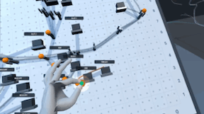
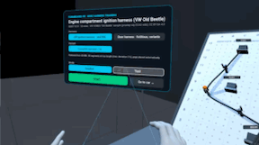
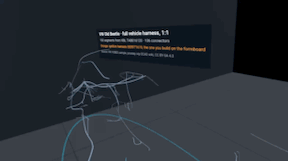

# Formboard VR

**Wire harness assembly training in VR, driven by KBL data.** A real VW harness from its KBL file is flattened 1:1 onto a virtual formboard. You route it wire by wire with your bare hands, and every peg is checked. At the end you see the finished formboard, and where the harness sits in the car. It runs in the browser on Meta Quest 3 (WebXR), with no install.

<p align="center">
  <a href="https://suavi-yildirim.github.io/formboard-vr/"><b>▶ Try it in the browser</b></a> &nbsp;·&nbsp;
  <a href="https://suavi-yildirim.github.io/formboard-vr/demo/"><b>🎬 VR Demo videos with sound</b></a>
</p>

<p align="center">English and German: EN | DE switch in the app and on the demo page</p>

<table>
  <tr>
    <td width="33%" align="center"><a href="https://suavi-yildirim.github.io/formboard-vr/demo/"></a></td>
    <td width="33%" align="center"><a href="https://suavi-yildirim.github.io/formboard-vr/demo/"></a></td>
    <td width="33%" align="center"><a href="https://suavi-yildirim.github.io/formboard-vr/demo/"></a></td>
  </tr>
  <tr>
    <td align="center"><b>Wiring by hand</b><br><sub>The wire grows to your fingertips; each correct peg snaps green.</sub></td>
    <td align="center"><b>Finished formboard</b><br><sub>Menu, guide pegs, <i>Show me</i>, an error, quality check, summary.</sub></td>
    <td align="center"><b>Real KBL data from an example car</b><br><sub>The full VW Old Beetle harness at 1:1; orange is the harness you build.</sub></td>
  </tr>
</table>

<sub>Recorded in the headset on Meta Quest 3. The GIFs are previews; the demo page has the videos in 720p with the app's sounds.</sub>

## How it works

1. **Choose a harness.** The **VW ignition harness** is real KBL data from the public VW "Old Beetle" sample: 18 wires and 20 connectors, flattened from the 3D vehicle geometry. The **door harness** is a fictitious example with variants from the KBL modules.
2. **Set the guide pegs.** Ghost pegs show where fork pegs and Y-pegs go; you pinch each one into place.
3. **Route the wires, one at a time.** Pinch the glowing wire end and pull it along the pegs. It snaps to the next correct peg with a click and a haptic tick. A wrong branch or a skipped peg flashes red and counts as an error.
4. **Guided or test mode.** *Guided* shows the route and the next peg. *Test* shows only the target connector, so you route from the board drawing; *Show me* hints are counted.
5. **Quality check and summary.** Time, errors and hints per wire, with a JSON log to download.
6. **The car.** The complete VW vehicle harness stands next to the workstation at 1:1, with the harness you just built glowing orange where it sits.

### Realistic where it matters

- **Hands, not rays.** Wires and pegs are handled at the pinch point between thumb and index fingertip. A wire is picked up only where the pinch closes, within 3 cm of its glowing end. Rays appear only for the panel and for teleporting.
- **Wires with their real length.** The held wire reaches from the last peg to your fingers under light tension, and it can't be pulled further than its KBL length. For the VW harness, the KBL wire lengths match the flattened board paths to the millimetre.
- **Parts from the KBL.** Connector housings are sized by cavity count and coloured from the part description. Spark-plug connectors are rubber boots, ring terminals are copper lugs, and splices are heat-shrink sleeves. Wires show their base and tracer colours.
- **A real formboard.** The board is plywood with the 1:1 drawing glued on, sized to the harness, at working height within arm's reach. Pegs, wires, connectors and your hands cast shadows, which helps you judge depth.

## Controls

| | Quest 3 (hands) | Quest 3 (controllers) | Desktop |
|---|---|---|---|
| Wires, pegs | Pinch at the wire end or peg | Trigger at the controller tip | Left-drag on the board |
| Panel buttons | Point and pinch | Point and trigger | Left-click |
| Moving | Walk; *Go to car* / *Back to the formboard* | Grip button: aim at the floor, release to teleport. Left stick walks, right stick turns 30° | Right-drag look, Shift + right-drag or arrow keys pan, scroll zoom |
| Language | EN \| DE on the menu panel | EN \| DE on the menu panel | EN \| DE in the help box |

Open the link in the Quest Browser and press *Enter VR*. Desktop browsers have no WebXR, so there the app runs in desktop mode.

## From KBL to formboard

KBL (VDA 4964) describes the wiring: connectors, wires, connections, modules and routing. A formboard needs a flat 1:1 layout. `tools/` turns one into the other:

- **`real_kbl.py`** reads real KBL 2.3/2.4 files: nodes, segments, connectors (including ring terminals placed as special terminals), wire colours with tracer stripes, cross-sections, and the **routing of every wire**.
  - **Flattening:** a formboard keeps every segment at its true length (wires are cut to length), while branches may turn freely. The layout starts from a plane projection (PCA, seen from above, never mirrored). It is then relaxed: segments are held at the KBL `Virtual_length` while nodes that come too close push apart. For the VW harness, all 30 segments end at their true length.
  - **Pegs:** fork pegs along long segments (one every 160 mm) and Y-pegs at branch points.
  - **Vehicle view:** the B-spline centre lines of the full vehicle harness, in vehicle coordinates.
- **`kbl_to_harness.py`** builds all app data (`src/data/*.json`). For the fictitious door harness it uses a hand-made layout (`data/board_layout.json`).

## Run and develop

```
python3 -m http.server     # then open http://localhost:8000
npm test                   # syntax check of all modules + unit tests (node --test)
npm run data               # rebuild src/data/*.json from the KBL files
```

```
src/core/    pure logic, unit tested: grid, harness (variants, bundles), router (snap / wrong / done),
             session (state machine, metrics), heldwire (shape of the held wire), rig (teleport maths)
src/scene/   three.js: workshop, board, wires, panel, vehicle, audio
src/input/   one pointer model for hands, controllers and mouse; teleport and stick movement
src/i18n.js  English and German texts
tools/       KBL -> app data
demo/        demo page with the Quest 3 recordings
test/        node --test
```

No build step: three.js comes from a CDN through an import map.

## Data

- **`data/vw/`:** the public Volkswagen VOBES "Old Beetle" sample from the [prostep ivip ECAD wiki](https://ecad-wiki.prostep.org/sample/2018-12-27-volkswagen-vobesng-old-beetle/), CC BY-SA 4.0 (see `data/vw/SOURCE.md`). According to the wiki, the samples are not valid specifications of a real harness.
- **Door harness:** fictitious, from the [KBL knowledge-graph demo](https://github.com/suavi-yildirim/bordnetz-knowledge-graph).

Code: MIT licence. Data derived from the VW sample: CC BY-SA 4.0.

## Roadmap

- Mixed reality on a physical board: Quest passthrough, with the board registered by markers on opposite corners or by a two-point touch calibration
- Unity 6 + Meta XR SDK port for the lab version, using the same harness data
- Study mode: compare guided and test runs, and paper vs. VR instructions, from the logged times and errors
- Real formboard layouts from the harness CAD export, when available, instead of flattening
